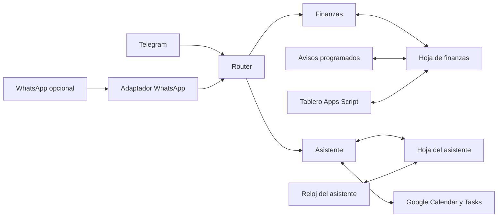
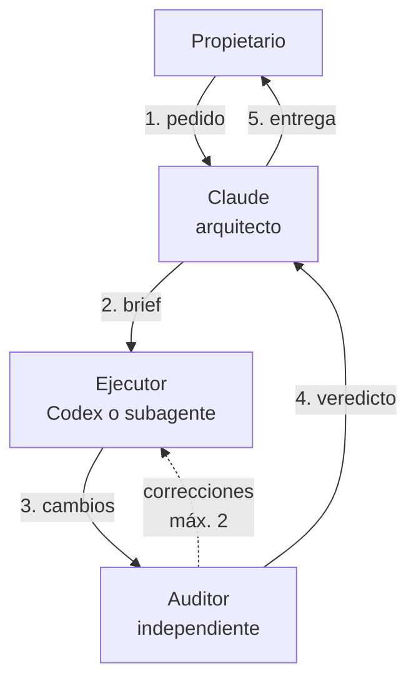

# Asistente personal y finanzas con n8n

Sistema de automatizaciones que convierte un chat de Telegram en un **asistente de finanzas personales y de organización diaria**. Por texto, voz o documentos registra gastos e ingresos, consulta saldos, administra deudas y cuotas, y organiza agenda, tareas, recordatorios y hábitos. Usa n8n, Google Sheets, Google Apps Script e IA, con una integración opcional con WhatsApp.

> Copia pública **anonimizada** de un proyecto personal, preparada el 8 de noviembre de 2026. Conserva el estado real del desarrollo y sus limitaciones; no es una instalación lista para activar sin configurar. No contiene datos de uso, conversaciones, credenciales ni el historial Git privado.

## Objetivo

Llevar las finanzas personales y la agenda sin abrir hojas de cálculo ni apps distintas: escribir *"gasté 25 mil en almuerzo con Nequi"* o *"recuérdame pagar la tarjeta el viernes"* y que el sistema entienda, valide, registre y responda. Los datos quedan en Google Sheets, bajo control del propietario, y un tablero web permite revisarlos y corregirlos.

## Herramientas

| Área | Tecnología |
|---|---|
| Orquestación | n8n (8 workflows, 143 nodos Code en JavaScript) |
| Canales | Bot de Telegram; WhatsApp Business opcional |
| IA | Modelos de lenguaje para interpretar mensajes; transcripción de voz (Whisper) |
| Datos | Google Sheets como base de datos (22 tablas), Google Calendar y Google Tasks |
| Tablero | Google Apps Script con HtmlService, HTML/CSS/JS |
| Pruebas | Node.js + Luxon para simular nodos Code; Python para validación y privacidad |

## Cómo funciona



1. **Router** recibe cada mensaje y decide si es de Finanzas o del Asistente.
2. **Interpretar → validar → ejecutar.** La IA propone una acción estructurada; el código resuelve referencias (cuentas, personas, categorías), valida montos y fechas y pregunta cuando falta información. Solo una acción aceptada se escribe en la hoja.
3. **Atajos** reconocen comandos frecuentes sin llamar al modelo, lo que reduce costo y latencia.
4. **Flujos programados** envían resúmenes, avisos de cuotas y presupuesto, actualizan precios y ejecutan recordatorios y hábitos.
5. **Tablero web** muestra saldos, patrimonio y deudas, y permite correcciones y pagos sobre la misma hoja.

Detalle en [arquitectura](docs/arquitectura.md) y [modelo de datos](docs/modelo-datos.md).

## Qué incluye

| Componente | Versión | Propósito |
|---|---|---|
| Finanzas · Bot | v25 | Registros y consultas por texto, voz y documentos |
| Finanzas · Programado | v7 | Avisos, resúmenes, precios y mantenimiento |
| Finanzas · Errores | v1 | Avisos de errores (limitaciones conocidas) |
| Asistente · Entrada | v6.4 | Agenda, pendientes, recordatorios y hábitos |
| Asistente · Reloj | v6.1 | Sincronización y ejecución de recordatorios y hábitos |
| Asistente · Errores | v1.1 | Manejo de errores del asistente |
| Router | v2 | Reparte mensajes entre Finanzas y Asistente |
| WhatsApp · Entrada | v2 | Adaptador opcional hacia el Router |
| Tablero web | v8 | Consulta y operaciones sobre la hoja de finanzas |

## Trabajo realizado

- Diseño de la arquitectura en dos dominios (finanzas y asistente) con una entrada común y un bot único.
- Modelo contable sobre hojas de cálculo: cuentas, transferencias, deudas sueltas, préstamos con cuotas, separación de capital e intereses, tarjetas e inversiones.
- Más de 25 iteraciones del bot de finanzas, corrigiendo casos reales de interpretación, duplicados y correcciones desde el chat.
- Flujos de errores, idempotencia para evitar registros dobles y reglas para no alterar saldos al corregir.
- Tablero web en Apps Script con dos temas visuales.
- Herramientas propias de verificación: chequeo estructural de workflows, simulador de nodos Code y validador de publicación.
- Anonimización completa para esta publicación (ver [privacidad](docs/privacidad.md)).

## Desarrollo con agentes de IA: Claude y Codex

El proyecto se construyó con un equipo de agentes de IA coordinado por una persona. El propietario define qué se quiere y aprueba los cambios importantes; los agentes diseñan, construyen y revisan.



**Roles**

| Rol | Quién | Qué hace |
|---|---|---|
| Arquitecto | Claude Code (sesión principal) | Entiende el pedido, clasifica la tarea, diseña la solución y redacta el brief. Revisa el veredicto antes de dar algo por terminado |
| Ejecutor ligero | Subagente de Claude (modelo pequeño) | Cambios simples y acotados |
| Escultor | Subagente de Claude o Codex | Construye los cambios complejos: nodos Code, JSON de flujos, tablero |
| Auditor | Otro Codex o subagente de solo lectura, distinto del que construyó | Compara el cambio contra los criterios de aceptación, sin ver el historial de la conversación |

**Cómo se clasificaba cada pedido**

- **Trivial:** lo resuelve el arquitecto directamente.
- **Simple:** ejecutor ligero; auditoría solo si hay riesgo.
- **Compleja:** escultor y después auditor, siempre.
- **Crítica** (dinero, saldos, varios módulos): plan aprobado por el propietario, luego escultor y auditor.

**Contrato entre agentes.** El arquitecto entrega solo lo necesario, sin el historial: `TASK_ID`, `OBJECTIVE`, `SCOPE`, `RELEVANT_FILES`, `CONSTRAINTS`, `ACCEPTANCE_CRITERIA` y `VALIDATION_COMMANDS`. El ejecutor responde `STATUS / FILES_CHANGED / SUMMARY / TESTS / RISKS / BLOCKERS`, y el auditor `VERDICT / FINDINGS / EVIDENCE / REQUIRED_FIXES`. Si el auditor pide correcciones, los hallazgos vuelven al mismo ejecutor; tras dos ciclos sin aprobar, el bloqueo se presenta al propietario.

**Reglas de seguridad del equipo**

- Separar quien construye de quien revisa: el auditor nunca audita su propio trabajo.
- Como máximo dos ejecutores en paralelo y en archivos distintos; el JSON del bot nunca se edita en paralelo.
- Ningún agente hace push, despliega ni escribe en la hoja real; eso lo hace el propietario.
- Cada tarea grande (WhatsApp, pruebas, tablero) se abre en una sesión propia con un brief autocontenido, para no arrastrar contexto y gastar menos tokens.
- El modelo más costoso solo se usa con una razón concreta.

**Herramientas de apoyo.** Skills de Claude Code para n8n (patrones, nodos Code, expresiones, errores, subflujos y autoalojamiento), Apps Script y diseño del tablero, más tres propias: `n8n-workflow-check` (chequeo y simulación de flujos, publicado en [scripts/](scripts/)), `auditar-entrega` (revisión del diff real antes de entregar) y `auditoria-proyecto` (auditoría completa bajo pedido). Ejemplo: el tablero v8 lo construyó Codex y lo auditó otro Codex, con Claude como arquitecto.

## Resultados

Comprobaciones locales sobre esta copia, sin conectar servicios reales ([detalle](docs/validacion.md)):

| Comprobación | Resultado |
|---|---|
| Workflows exportados | 8 JSON válidos, desactivados y con conexiones coherentes |
| Sintaxis de nodos Code | 143/143 compilan |
| Normalización Finanzas | 5/5 casos sintéticos |
| Asistente, Router y WhatsApp | 12/12 aserciones |
| Tablero y plantilla | 8/8 grupos de pruebas |
| Configuración pública | 5/5 pruebas |
| Validador de publicación | 0 hallazgos de secretos o datos personales |

Las limitaciones pendientes se documentan con honestidad en [estado y limitaciones](docs/estado-y-limitaciones.md).

## Habilidades aplicadas

Automatización de procesos con n8n · JavaScript · Python · integración de APIs (Telegram, Google, WhatsApp, modelos de IA) · diseño de prompts y salidas estructuradas · modelado de datos contables · Google Apps Script · pruebas y validación automatizada · manejo de errores e idempotencia · seguridad y anonimización de datos · documentación técnica · orquestación de agentes de IA (Claude Code y Codex) con roles, contratos y auditoría independiente.

## Estructura

```text
flujos/          Exports de n8n desactivados y anonimizados
apps-script/     Tablero web en Apps Script
plantillas/      Esquemas vacíos e inicializadores de las hojas
config/          Ejemplos de configuración sin secretos
scripts/         Verificaciones locales y simulación de nodos Code
tests/           Casos inventados, sin datos reales
docs/            Arquitectura, instalación, aprendizajes y límites
```

## Probarlo

1. Lee [estado y limitaciones](docs/estado-y-limitaciones.md).
2. Prepara las hojas con las [plantillas](plantillas/) y el [modelo de datos](docs/modelo-datos.md).
3. Sigue la [instalación por módulos](docs/instalacion.md) y las guías de [Finanzas](docs/finanzas.md), [Asistente](docs/asistente.md) y [tablero](docs/tablero.md).
4. Asigna tus credenciales y sustituye los valores de ejemplo según [configuración](config/README.md).
5. Ejecuta la validación local:

```bash
python -X utf8 scripts/validar_publicacion.py
npm ci --ignore-scripts
npm test
python -X utf8 tests/configuracion-publica.test.py
```

[Lecciones aprendidas](docs/lecciones-aprendidas.md) reúne problemas técnicos y decisiones reutilizables.

## Licencia

No se ha elegido una licencia de redistribución; consulta [NOTICE](NOTICE.md).
