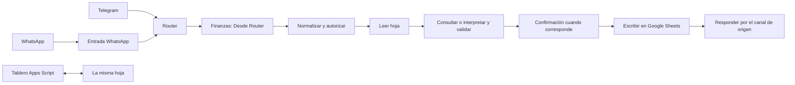

# Módulo de finanzas

Este módulo registra y consulta finanzas personales en pesos colombianos desde Telegram y, en la integración más reciente disponible, WhatsApp. Google Sheets conserva movimientos, cuentas, deudas, cuotas, documentos e inversiones. El tablero de Apps Script presenta esos mismos datos.

La publicación reúne las últimas fuentes locales disponibles. Es una copia de referencia para configurar una instalación propia; no demuestra una instalación nueva ya probada en servicios reales. Se mantuvieron los pendientes del proyecto, sin construir funciones nuevas.

## Versiones incluidas

| Archivo | Nodos | Función y procedencia |
|---|---:|---|
| `flujos/finanzas/finanzas-bot-v25.json` | 132 | Última versión disponible en el módulo de integración: incorpora entrada desde Router y adaptación de respuestas a WhatsApp. |
| `flujos/finanzas/finanzas-programado-v7.json` | 34 | Última versión disponible del módulo Finanzas: avisos, resúmenes, precios y respaldos. Sus envíos siguen siendo por Telegram. |
| `flujos/finanzas/finanzas-errores-v1.json` | 5 | Última versión disponible del manejador de errores de Finanzas; conserva limitaciones conocidas. |

Las versiones anteriores y el historial privado no se incluyen. El archivo v25 sustituye al v23 como referencia pública porque conserva la integración posterior disponible. Esto no certifica qué versión estuvo publicada en el servidor original.

## Recorrido de un mensaje

El diagrama resume las rutas; una consulta no tiene por qué escribir movimientos y una entrada puede terminar rechazada o cancelada.

La lógica principal vive en los nodos Code `Contexto`, `Plan`, `Consultar` y `Ejecutar`. `Solicitudes` prepara las escrituras por lote. La v25 conserva el `Telegram Trigger` desactivado porque la entrada normal llega a `Desde Router`.

## Preparar una instalación

1. Cree una hoja y sus pestañas con [el esquema de Finanzas](../plantillas/finanzas-esquema.json) y [CrearPlantilla.gs](../plantillas/CrearPlantilla.gs), que inicializa sin sobrescribir. Siga [el modelo de datos](modelo-datos.md) y use [los datos inventados de ejemplo](../plantillas/datos-demo.example.json) si necesita una primera prueba. Conserve exactamente los encabezados; una hoja vacía sin esas pestañas no basta. Agregue sus propias cuentas, categorías, personas y parámetros. No se distribuye la base financiera del proyecto original.
2. Cree un bot propio de Telegram, averigüe el ID de su chat y cree carpetas privadas de Drive para comprobantes, extractos procesados y respaldos. La carpeta de extractos utiliza `CONFIGURE_EXTRACTS_FOLDER_ID` en el nodo `Mover a Extractos`.
3. Cree en n8n las credenciales de la tabla siguiente. Los JSON incluyen referencias de ejemplo; no incluyen tokens, claves ni sesiones OAuth.
4. Trabaje sobre copias privadas de los JSON. Consulte [el inventario de configuración](../config/finanzas.example.json), que identifica los marcadores y los nodos donde aparecen. Ese archivo describe la configuración: n8n no lo lee automáticamente.
5. Reemplace `CONFIGURE_FINANCE_SHEET_ID`, las carpetas Drive y el chat ficticio `123456789` en **todas** sus apariciones. Cambiar solo el nodo `Config` no basta: hay URLs, controles de autorización y envíos que también contienen estos valores.
6. Complete los marcadores `CONFIGURE_OWNER_*` del prompt y la expresión de reconocimiento del titular en `Ejecutar`. Así se distinguen transferencias propias de pagos a otras personas. `CONFIGURE_OWNER_MATCH` está dentro de una expresión regular JavaScript: conserve `/.../i` y escape los caracteres especiales de su patrón.
7. Si usará WhatsApp, configure `CONFIGURE_WHATSAPP_ALLOWED_NUMBER` y `CONFIGURE_WHATSAPP_PHONE_NUMBER_ID`, además de la credencial `whatsAppApi` y el módulo de entrada correspondiente. El primero es el número autorizado, sin `+`; el segundo es el identificador técnico de Meta, no el teléfono. Cree las Data Tables compartidas descritas en [whatsapp-tablas.json](../plantillas/whatsapp-tablas.json) y seleccione sus IDs en los nodos `WA Reservar entrada`, `WA Reservar confirmación`, `WA Leer reserva entrada`, `WA Leer reserva confirmación` y `WA Guardar contexto` (`CONFIGURE_WHATSAPP_LOCKS_TABLE_ID` y `CONFIGURE_WHATSAPP_CONTEXT_TABLE_ID`). Deben ser las mismas tablas que utiliza la entrada de WhatsApp. Para una instalación solo con Telegram, las rutas de WhatsApp no necesitan publicarse.
8. Importe primero el flujo de errores. Anote su ID local y configure `Settings → Error workflow` en Bot y Programado. Sustituya `CONFIGURE_FINANCE_ERROR_WORKFLOW_ID`; los IDs de otra instancia no sirven en la propia.
9. Importe Bot y Programado y reasigne todas sus credenciales. En el Router, seleccione el ID local de Finanzas como destino. Siga la guía del Asistente/Router para enlazar los demás subflujos.
10. Mantenga el `Telegram Trigger` de Finanzas desactivado. Publique el Router como único receptor de ese bot y active los avisos programados después de probar su configuración. Los archivos se entregan con `active: false`; n8n generará los identificadores de webhook necesarios al importar/publicar.
11. Para el tablero, copie los archivos de Apps Script a la misma hoja, despliegue con acceso limitado a su cuenta y configure `/tablero` con su propio enlace. Las instrucciones del tablero explican la actualización de una implementación.

No active dos Telegram Trigger que compartan el mismo token: la entrada de la instalación integrada pertenece al Router. Para reemplazar un flujo ya instalado, haga primero un respaldo privado y revise el orden de desactivación/publicación de su instalación.

### Credenciales referenciadas

| Tipo en n8n | Para qué se utiliza |
|---|---|
| `telegramApi` | Recibir, contestar botones, descargar adjuntos y enviar respuestas o avisos. |
| `googleSheetsOAuth2Api` | Lectura y escritura de la base de finanzas y del log. |
| `googleDriveOAuth2Api` | Comprobantes y copias de respaldo. |
| `googlePalmApi` | Nodos Gemini para interpretación de texto, audio y documentos. |
| `httpHeaderAuth` | Respaldo de transcripción por Groq; configure su autorización en la credencial. |
| `whatsAppApi` | Descarga/envío en las rutas de WhatsApp de la v25. |

Los nombres e identificadores de credencial se sustituyeron por `CONFIGURE_<tipo_n8n>` y `<tipo_n8n> (configurar)`. Seleccione credenciales propias desde la interfaz de n8n. Los identificadores internos de nodo se regeneraron y se retiraron metadatos de instancia y los `webhookId` originales; las conexiones por nombre se conservan.

Los modelos, versiones de nodos y endpoints son los que referencian los archivos disponibles. Antes de publicar su instalación, compruebe que su servidor n8n y sus cuentas admitan esos modelos y operaciones; esta preparación no hizo llamadas externas para verificarlos.

## Qué hace el Programado

Sus disparadores incluyen avisos diarios, resumen semanal y actividades mensuales. Revise las horas en los nodos Schedule Trigger y la zona `America/Bogota` antes de activarlo. También consulta proveedores externos de precios y utiliza QuickChart para las gráficas: esas solicitudes pueden incluir cifras o etiquetas de sus resúmenes financieros.

Las copias de respaldo se guardan en la carpeta configurada y la ruta de retención puede eliminar respaldos antiguos de esa carpeta. Use una carpeta exclusiva y revise `Copiar hoja`, `Buscar respaldos`, `Respaldos viejos` y `Borrar respaldo viejo` antes de activar ese recorrido. La publicación no ejecutó esa tarea ni eliminó archivos.

## Pruebas sugeridas en una hoja de prueba

Use cuentas y personas ficticias creadas por usted; por ejemplo, una cuenta `Efectivo demo` y una `Persona demo`.

- **Registro válido:** «Gasté 1.000 en transporte desde Efectivo demo»; revisar categoría, cuenta, monto y una sola operación en la hoja.
- **Consulta:** `/saldos` y «¿Cuánto me debe Persona demo?»; comprobar que no se creen pagos por hacer una pregunta.
- **Entrada inválida:** pedir un registro sin monto; el flujo debe pedir información o rechazarlo, sin inventar un valor.
- **Duplicado:** confirmar un botón dos veces rápido; comprobar una sola escritura.
- **Corrección y deshacer:** corregir un registro propio de prueba y deshacerlo; revisar los saldos y las filas afectadas.
- **Canales:** repetir texto, una voz y una imagen por los canales configurados; comprobar que responda por el canal de origen.
- **Programado:** ejecutar manualmente una rama de avisos sobre datos ficticios; revisar cuotas, destinatario y hora antes de activar sus disparadores.
- **Tablero:** registrar un pago de prueba y deshacerlo; contrastar los saldos con los del bot.

## Pendientes y límites que se conservan

- `Finanzas - Errores v1` conserva dos defectos detectados por el validador heredado: `Avisar error` no fija `parse_mode: HTML` ni escapa el texto dinámico. Algunos caracteres pueden romper el envío. También conserva una lectura individual de Google Sheets. Se publica como estado histórico disponible, no como manejador de errores corregido.
- El manejador v1 no resuelve el caso de una ejecución fallida antes de que exista su fila de log; la versión posterior con creación de fila y antirrepetición sigue pendiente.
- Corregir/deshacer todavía puede borrar físicamente filas. La anulación con historial y el deshacer completo de préstamos, reventas e inversiones siguen pendientes.
- El bot y el tablero repiten parte del cálculo financiero. Sus cambios deben contrastarse entre ambos y con `Reporte` del Programado. Sus candados no coordinan todas las escrituras entre módulos.
- La decisión sobre sobrantes en cobros de grupos sigue siendo una mejora pendiente.
- Esta publicación no migra datos privados ni demuestra conciliación de los saldos de otra instalación.

## Verificación realizada para preparar la copia

| Comprobación local | Resultado |
|---|---|
| Bot v25: estructura, conexiones, referencias y chequeo heredado | 0 errores; 1 aviso por el Telegram Trigger deliberadamente desactivado. |
| Programado v7: chequeo heredado | 0 errores y 0 avisos. |
| Errores v1: chequeo heredado | 2 errores y 1 aviso heredados, descritos arriba. |
| Sintaxis de los nodos Code | Compilan los 42 del Bot y los 10 del Programado. Errores v1 no contiene nodos Code. |
| Simulación local de `Normalizar` | 5/5 casos: texto, botón, voz, entrada sin mensaje y repetición de la misma entrada. No prueba la escritura posterior ni Telegram. |

No se ejecutaron estos flujos dentro de n8n ni se probaron tokens, OAuth, Telegram, WhatsApp, Gemini, Groq, Drive, Sheets, la publicación del Router o las escrituras reales. Los resultados estáticos no certifican el comportamiento integral.
